# Manual: monta una red segmentada en AWS desde cero

*VLANs en AWS · paso a paso, sin instalar nada y sin conocimientos previos*

Este manual te lleva de la mano, desde no tener nada hasta tener funcionando en Amazon Web Services (AWS) una red dividida en tres capas aisladas, con una aplicación real encima, y luego a borrarla. **No necesitas saber de redes ni de programación, ni instalar nada en tu computador:** todo se hace desde el navegador, copiando y pegando cuatro comandos.

## Lo que vas a construir

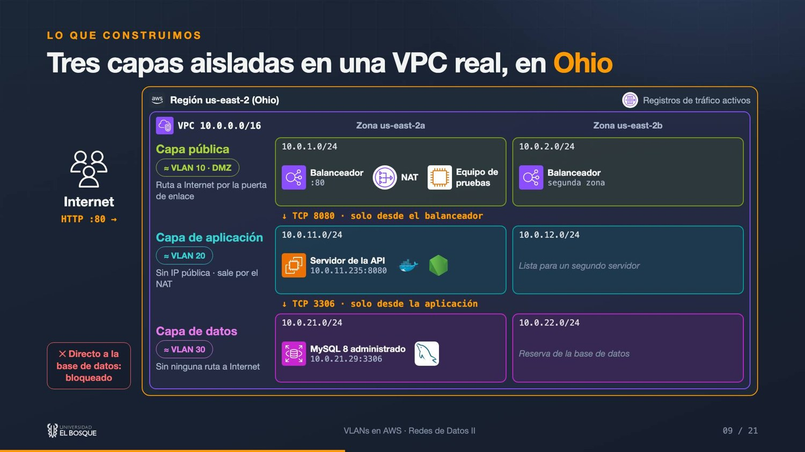

*La red que vas a crear: tres capas, cada una en su propia subred, y cada una solo acepta a la anterior.*

En una red tradicional los equipos se separan con VLANs. En AWS no hay VLANs: se separan con **subredes**, **tablas de ruteo** y **reglas**. Vas a crear una red privada (VPC) con tres capas:

- **Capa pública:** la única que se ve desde Internet. Tiene el balanceador, que recibe a los visitantes.
- **Capa de aplicación:** un servidor privado con una pequeña aplicación de reservas. Solo acepta al balanceador.
- **Capa de datos:** una base de datos MySQL. Solo acepta a la aplicación y no tiene ninguna salida a Internet.

## Antes de empezar

| Necesitas | Para qué |
|---|---|
| Un computador con navegador | Chrome, Edge, Firefox o Safari. Sirve Windows, Mac o Linux. |
| Un correo electrónico | Será el usuario de tu cuenta de AWS. |
| Un celular | AWS envía un código para verificar tu identidad. |
| Una tarjeta de crédito o débito | AWS la pide para verificar la identidad. Con el plan gratuito no te cobra. |
| Unos 40 minutos | 15 para la cuenta, 10 para desplegar, 10 para mirar y probar, y 5 para borrar. |

> ⚠️ **La red consume créditos mientras esté encendida.** En nuestra cuenta gastó unos 20 USD de crédito en tres días. El plan gratuito trae 100 USD de crédito y no cobra dinero real, pero cuando termines haz siempre el **paso 7 (borrar todo)**.

## Paso 1 · Crea tu cuenta de AWS

1. Entra a **https://aws.amazon.com/es/free/** y haz clic en **Crear una cuenta gratuita**.
2. Escribe tu correo y un nombre para la cuenta (por ejemplo `redes-vlans`). AWS te envía un código al correo: escríbelo.
3. Crea una contraseña. Guárdala bien: es la del dueño de la cuenta.
4. Cuando te pregunte por el plan, elige **Gratuito** (Free). Es el que da los 100 USD de crédito y no cobra.
5. Llena tus datos de contacto (tipo de cuenta **Personal**) y los de la tarjeta.
6. Verifica tu celular con el código que te llega por mensaje o llamada.
7. En el plan de soporte elige **Básico (gratis)**.
8. Espera el correo de bienvenida de AWS. Puede tardar unos minutos.

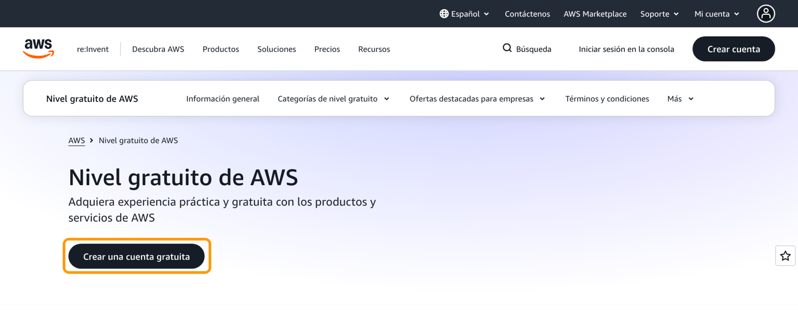

*La página de inicio. El botón «Crear una cuenta gratuita» abre el formulario de registro.*

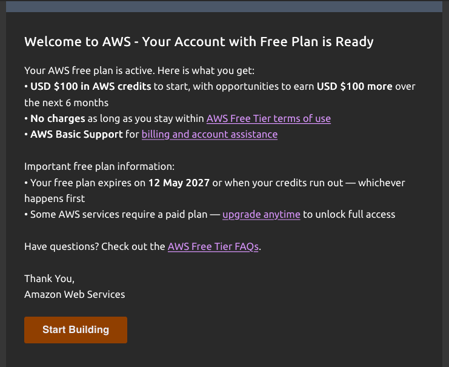

*El correo que confirma que la cuenta está lista: plan gratuito, 100 USD de crédito y seis meses de vigencia.*

## Paso 2 · Entra a la consola y abre CloudShell

La **consola** es la página desde la que se maneja AWS. **CloudShell** es una ventana de comandos que vive dentro de la consola: ya trae todo instalado y ya sabe quién eres, así que no hay que configurar nada.

1. Entra a **https://console.aws.amazon.com/** e inicia sesión con tu correo y tu contraseña (opción *usuario raíz*).
2. Si aparece una ventana de bienvenida, ciérrala con la X.
3. Haz clic en el ícono de CloudShell: es un cuadrito con los símbolos `>_`, arriba a la derecha (también está abajo a la izquierda, con el nombre **CloudShell**).
4. La primera vez muestra un mensaje de bienvenida: haz clic en **Cerrar**.
5. Espera a que aparezca una línea que termina en `$`. Ahí es donde vas a pegar los comandos.

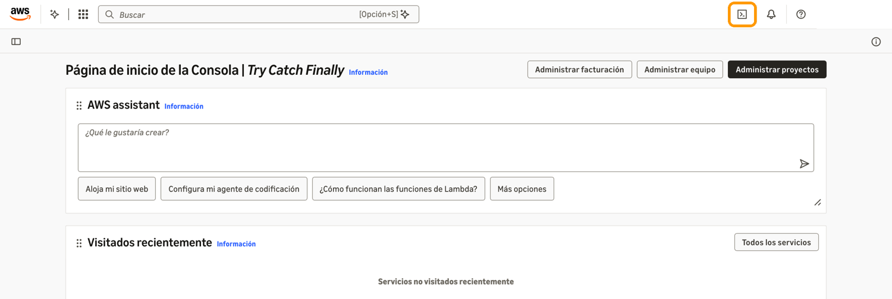

*La consola de AWS. El ícono de CloudShell está arriba a la derecha y abajo a la izquierda.*

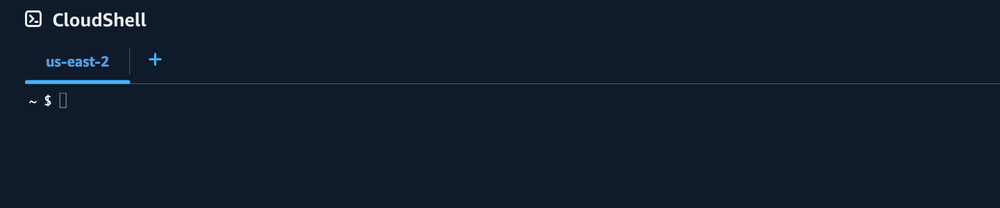

*CloudShell listo: la línea que termina en $ espera tus comandos.*

> 💡 **Cómo pegar un comando:** cópialo de este manual, haz clic dentro de la ventana negra y pega con `Ctrl + V` (en Mac, `Cmd + V`). Luego presiona `Enter`. Pega **un comando a la vez** y espera a que vuelva a aparecer el `$` antes de pegar el siguiente.

## Paso 3 · Descarga el proyecto

Este comando trae a CloudShell todos los archivos del proyecto y entra en su carpeta:

```bash
git clone https://github.com/havo-ao/vlans-en-aws.git && cd vlans-en-aws
```

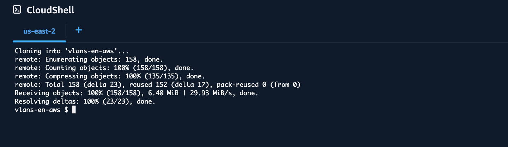

*Al terminar, la línea de comandos muestra el nombre de la carpeta: vlans-en-aws.*

## Paso 4 · Prepara las herramientas

Este comando instala Terraform (el programa que construye la red) y revisa que tu cuenta pueda crear la red en la región donde estás:

```bash
./1-preparar.sh
```

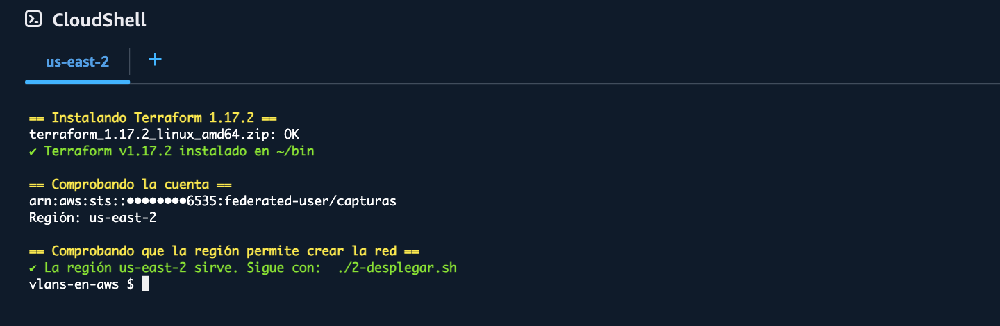

*Tres chulos verdes: Terraform instalado, cuenta reconocida y región apta.*

> ⚠️ **Si aparece una X roja que dice que la cuenta no permite crear redes en esa región:** en las cuentas nuevas suele funcionar una sola región. Mira la dirección de la página en el navegador: la región es el texto del tipo `us-east-2`. Prueba abrir la consola en otra región cambiando ese texto en la dirección (por ejemplo `us-east-2`, que es Ohio y es la que nos sirvió), abre CloudShell otra vez y repite los pasos 3 y 4.

## Paso 5 · Despliega la red

Este es el comando principal. Crea los 46 elementos de la red, espera a que la aplicación arranque y te muestra su dirección:

```bash
./2-desplegar.sh
```

Tarda **entre 7 y 10 minutos**. Verás pasar muchas líneas: es Terraform contando lo que va creando. Lo que más demora es la base de datos. **No cierres la pestaña.**

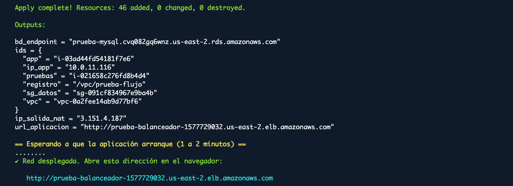

*Al final aparece «Apply complete! Resources: 46 added» y la dirección de tu aplicación.*

1. Copia la dirección que aparece en color (empieza por `http://` y termina en `amazonaws.com`).
2. Ábrela en una pestaña nueva del navegador.
3. Crea una reserva: escribe un nombre, elige una sala y una fecha, y haz clic en **Reservar**.

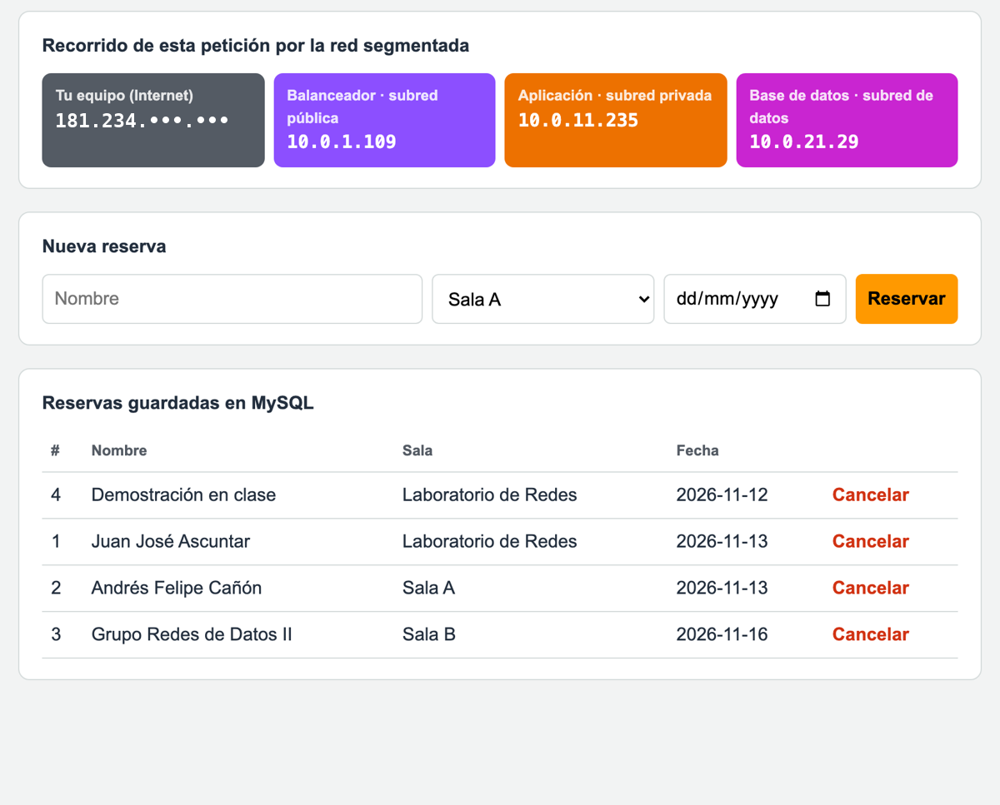

*La aplicación funcionando. Arriba muestra por dónde pasó tu visita: balanceador, servidor de aplicación y base de datos, cada uno en su capa.*

> 💡 Si la página muestra un error 502 o no carga, espera un minuto y recarga: el servidor todavía está terminando de arrancar la aplicación.

## Paso 6 · Comprueba que las capas están aisladas

Este comando hace siete intentos de conexión, desde distintos lugares, y te dice si cada uno salió como debía:

```bash
./3-probar.sh
```

![Los siete intentos. [OK] significa que la red se comportó como se diseñó.](img/10_probar.png)

*Los siete intentos. [OK] significa que la red se comportó como se diseñó.*

| Intento | Qué debe pasar | Por qué |
|---|---|---|
| 1. De fuera al balanceador | Responde | Es la única puerta abierta al público |
| 2. De fuera a la base de datos | Sin respuesta | No tiene dirección pública ni ruta a Internet |
| 3. De fuera a la aplicación | Sin respuesta | Solo se llega a ella por el balanceador |
| 4. De la capa pública a la base de datos | Sin respuesta | La base de datos solo acepta a la aplicación |
| 5. De la capa pública a la aplicación | Sin respuesta | La aplicación solo acepta al balanceador |
| 6. De la aplicación a la base de datos | Abierto | Es el único origen permitido |
| 7. De la aplicación a Internet | Sale con otra dirección | Sale a través del NAT; nadie puede entrar por ahí |

### Si quieres ver la red en la consola (opcional)

1. En la barra de búsqueda de la consola escribe **VPC** y entra.
2. Haz clic en **Sus VPC** y luego en la que se llama `vlans-vpc`.
3. Baja hasta **Mapa de recursos**: verás las seis subredes y hacia dónde sale cada una.

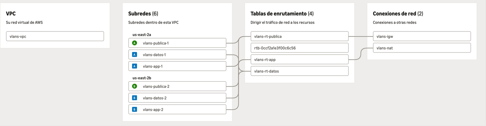

*El mapa de recursos: las subredes públicas salen a Internet, las de aplicación al NAT y las de datos a ninguna parte.*

## Paso 7 · Borra todo

Cuando termines, borra la red para que la cuenta no siga gastando créditos:

```bash
./4-destruir.sh
```

Te pide confirmación: escribe `SI` (en mayúsculas) y presiona `Enter`. Tarda **unos 5 minutos**; lo que más demora es borrar la base de datos.

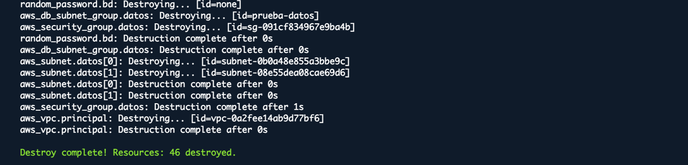

*«Destroy complete! Resources: 46 destroyed»: se borraron los 46 elementos.*

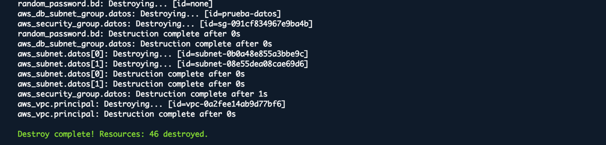

*La verificación final: el chulo verde confirma que no quedó nada encendido.*

> ✅ Si al final aparece el chulo verde **«No queda ningún recurso del proyecto»**, terminaste. Puedes cerrar la pestaña.

## Si algo sale mal

| Qué pasó | Qué hacer |
|---|---|
| CloudShell se cerró o se quedó en blanco | Vuelve a abrirlo, escribe `cd vlans-en-aws` y repite el comando en el que ibas. No se pierde lo que ya se creó. |
| Se cerró a mitad del paso 5 | Abre CloudShell, escribe `cd vlans-en-aws` y vuelve a ejecutar `./2-desplegar.sh`: continúa donde quedó. |
| Dice «Permission denied» al ejecutar un paso | Estás fuera de la carpeta. Escribe `cd ~/vlans-en-aws` e inténtalo de nuevo. |
| La región no sirve (X roja en el paso 4) | Cambia de región como se explica en el paso 4. |
| La aplicación muestra error 502 | Espera uno o dos minutos y recarga la página. |
| Quieres empezar de cero | Ejecuta `./4-destruir.sh`, espera el chulo verde y repite desde el paso 5. |
| No estás seguro de si quedó algo encendido | Ejecuta `./4-destruir.sh --si`. Si no hay nada, lo dice. |

## Qué hace cada comando por dentro

Los cuatro comandos son atajos. Por dentro usan Terraform, una herramienta que lee archivos de texto donde está descrita la red y la crea en AWS.

| Comando | Lo que hace realmente | Archivos que usa |
|---|---|---|
| `./1-preparar.sh` | Descarga Terraform, verifica su integridad y pregunta a AWS si la región permite crear la red | `scripts/comun.sh` |
| `./2-desplegar.sh` | `terraform init` (descarga el conector de AWS) y `terraform apply` (crea los 46 recursos) | `infra/red.tf`, `seguridad.tf`, `datos.tf`, `computo.tf` |
| `./3-probar.sh` | Ejecuta comandos dentro de los servidores con AWS Systems Manager y compara cada resultado con lo esperado | `pruebas/pruebas.py` |
| `./4-destruir.sh` | `terraform destroy` y luego busca si quedó algún recurso del proyecto | El estado guardado en `infra/` |

Si quieres leer cómo está escrita la red, abre la carpeta `infra/` del repositorio. Lo esencial está en tres ideas:

- **Subredes** (`red.tf`): cada capa es un rango de direcciones distinto, 10.0.1.x, 10.0.11.x y 10.0.21.x.
- **Tablas de ruteo** (`red.tf`): la capa pública sale a Internet, la de aplicación solo sale por el NAT y la de datos no sale.
- **Reglas encadenadas** (`seguridad.tf`): cada capa solo acepta conexiones de la capa anterior, en un puerto concreto.

## Palabras que aparecen en el manual

| Palabra | Qué significa |
|---|---|
| AWS | Amazon Web Services: la nube de Amazon, donde se alquilan servidores y redes por horas. |
| VPC | *Virtual Private Cloud*, nube privada virtual: tu red privada dentro de AWS. |
| Subred | Un trozo de la red con su propio rango de direcciones. Hace el papel de la VLAN. |
| Balanceador | Recibe a los visitantes y los pasa a la aplicación. |
| NAT | *Network Address Translation*: deja que los servidores privados salgan a Internet sin que nadie pueda entrar a ellos. |
| Terraform | Programa que crea la red a partir de archivos de texto. |
| CloudShell | La ventana de comandos que viene dentro de la consola de AWS. |
| Región | El lugar del mundo donde AWS crea tus recursos. `us-east-2` es Ohio, en Estados Unidos. |
| Crédito | Saldo de regalo del plan gratuito. Lo que consumes se descuenta de ahí, no de tu tarjeta. |

Todo el proyecto está en **https://github.com/havo-ao/vlans-en-aws**. Autores: Juan José Ascuntar y Andrés Felipe Cañón · Redes de Datos II · Universidad El Bosque.
